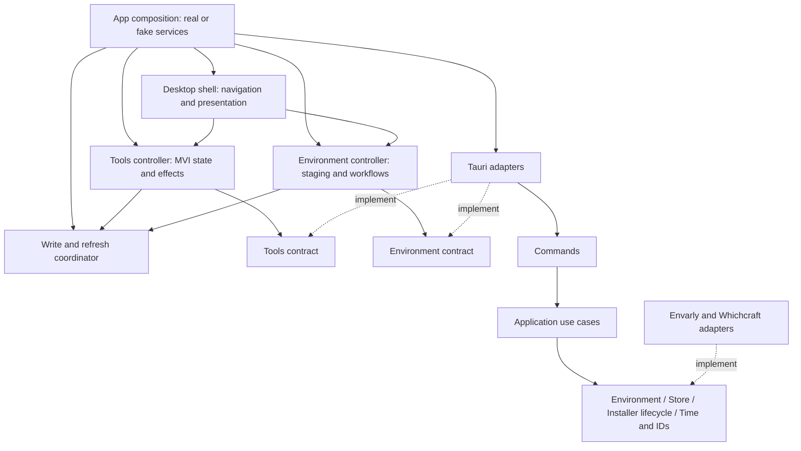

# Architecture review — desktop UI integration

Date: 2026-10-24
Status: incorporated-in-spec

## Conclusion

ดีไซน์ใหม่ควรเปลี่ยนทั้งการนำทางและขอบเขตความรับผิดชอบของ frontend การย้าย JSX จากหน้าเดิมไปวางใน navigation ใหม่อย่างเดียวจะยังทิ้ง flow ของ Environment ไว้ใน root และทำให้การประสานข้อมูลกับ Tools เปราะบาง ขณะเดียวกันไม่จำเป็นต้องเขียน backend ของ Envarly ใหม่หรือบังคับให้ state ของทั้งแอปอยู่ใน reducer ก้อนเดียว

ADR-0005 กำหนด MVI ของหน้าเครื่องมือและ dependency ชี้เข้าด้านในของ Whichcraft Rust ไม่ได้ห้าม React hooks หรือสั่งย้าย type ของ Envarly ทั้งหมดเข้า domain จึงต้องแยกประเด็นเรื่อง ownership/injection ออกจากการเลือก syntax ของ state management

## Evidence from the production code

Prototype components are design evidence only; this review concerns the production composition and adapters.

| Finding | Current evidence | Consequence | Required action |
| --- | --- | --- | --- |
| Root owns Environment orchestration | [App](../../src/App.tsx) invokes variable loading, staging, local undo, account switching, PATH status, external diff, apply and diagnostics; also selects dialogs and composes Tools | Moving UI panels alone retains the environment-first controller in the app root | Extract an Environment feature controller with a stable state/actions boundary; root composes workspaces and shared services |
| Environment hooks depend on presentation setters | [useApplyStaged](../../src/hooks/useApplyStaged.ts) accepts setDialog and baselineRef; [useStagingHandlers](../../src/hooks/useStagingHandlers.ts) accepts selection/dialog/snapshot-panel setters | Business flow and modal placement cannot evolve independently; closing/unmounting a view can become part of operation completion | Return feature outcomes and expose actions/state; feature presentation decides the dialog/tab response; retain tested staging and validation helpers internally |
| Environment views reach global API | [ExportTab](../../src/components/ImportExportPanel/ExportTab.tsx), [ImportTab](../../src/components/ImportExportPanel/ImportTab.tsx), [CheckCommandPanel](../../src/components/CheckCommandPanel/CheckCommandPanel.tsx), [useSnapshotPanel](../../src/components/SnapshotPanel/useSnapshotPanel.ts) import the singleton API | One app-level injected API will not control all effects unless these consumers are migrated | Route migrated feature calls through injected feature contracts, including progress subscriptions and file interactions |
| Progress setup can escape operation cleanup | useApplyStaged sets busy and awaits onApplyProgress before entering its try/finally | A rejected subscription can leave the controller busy without cleanup; moving the panel alone preserves this failure path | Include subscription acquisition in the operation lifecycle and test failed setup through the injected API |
| Tool MVI is already a useful seam | [ToolsStore](../../src/features/tools/useToolsStore.ts) owns reducer/effect dispatch and accepts an API; [tool model](../../src/features/tools/model.ts) represents one tool plus operation state | Keep the existing workflow; add overview reads without replacing it or merging every screen into one state object | Feature controller consumes a narrow Tools contract; overview reads are keyed by tool, account context and request revision |
| API facade mixes four roles | [api](../../src/api.ts) defines EnvarlyApi, calls invoke/listen, selects normal/demo behaviour and forwards all calls | Features inherit Tauri/demo/global-singleton knowledge and a contract larger than their needs | Separate type-only feature contracts, Tauri adapters, and launch/demo composition; retain a compatibility facade for unmigrated callers |
| Type declarations have several owners | [types](../../src/types.ts) includes Environment values, command hits, tool installations/plans, terminal/settings, recovery/uninstall and profiles | Ownership is unclear and a small feature tends to import a broad shared barrel | Move declarations to actual owners or shared transport contracts; keep compatible type re-exports during migration; do not change serialized names or value kinds |
| Cross-workspace mutation ownership is not yet explicit | App currently wires Tools and Environment refresh paths separately; tool state and environment state in the prototype are deliberately independent | A tool apply and an Environment edit can leave stale read models or race if the new shell merely mounts both | One app-lifetime coordinator guards conflicting UI write operations and publishes scoped invalidation; feature controllers retain ownership of their workflows |
| Application imports persistence for ID generation | [tool apply](../../src-tauri/src/whichcraft/application/tool_apply.rs), [profiles](../../src-tauri/src/whichcraft/application/profiles.rs), [PATH cleanup](../../src-tauri/src/whichcraft/application/path_cleanup.rs) import persistence::new_journal_id | Application has an outward dependency despite obtaining storage through Store | Inject operation IDs/time through a small application-owned port/context, wired by composition |
| Application reads wall-clock time directly | Tool apply and [uninstall](../../src-tauri/src/whichcraft/application/uninstall.rs) use chrono::Utc::now for recorded timestamps/IDs | IDs and timestamps cannot be controlled fully at the use-case test seam | Supply deterministic time/IDs to application use cases; keep formatting pure and persistence compatibility intact |
| mise bootstrap/status commands bypass App | [Whichcraft commands](../../src-tauri/src/commands/whichcraft.rs) call mise_status and prepare_mise directly; [tool-manager port](../../src-tauri/src/whichcraft/ports/tool_manager.rs) lacks those lifecycle operations | Loading state on the new home needs an exception to the usual commands → application → ports flow | Expose status/preparation as application methods through an installer lifecycle port; the concrete mise code remains an adapter |

The persistence import above is an ID/time dependency, not evidence that those production use cases are directly writing journal files. Actual journal reads/writes already use Store. Many adapter/persistence/std::fs imports lower in application source files are inside test modules; they must not be misreported as production violations.

The existing [architecture assessment](../../docs/architecture-assessment.md) explicitly records the Clock and mise-command compromises. This review updates the remaining work rather than treating the earlier completed architecture refactor as absent.

## Target responsibilities

The arrows to the coordinator mean explicit write admission and invalidation notifications; feature controllers must not import each other's reducer, private hooks or UI state. The two frontend contracts may share the same underlying production adapter. There is still one app-level injection point for tests, with narrow interfaces passed to feature consumers.

### Desktop shell and feature controllers

- Root constructs/injects services and mounts app-lifetime controllers. It owns navigation, application-wide presentation preferences and the presentation of operation status, not Environment validation or tool use-case decisions.
- Tools keeps its existing reducer/effect architecture. Overview/cache state is distinct from the selected-tool inspection state so switching tools does not relabel an older response.
- Environment owns account context, variables, staging, baseline/external diff, apply progress, snapshot/import/export and command-lookup state. Its public boundary is state plus explicit actions/outcomes. Existing tested hooks and pure helpers can be retained inside that feature, but UI setters must not be the interface of its apply/import/restore workflows.
- Dialog visibility, active tab and local draft presentation can remain local UI state. Active operations, staged edits and subscriptions must not be tied to a tab component's mount lifetime.
- No compulsory global reducer, replacement state library, cross-feature event bus or one generic workflow engine. Shared undo primitives and existing persistence semantics remain intact; local edit undo and applied tool-change Undo remain distinguishable.

### Write coordination and consistency

- The coordinator's lifetime is the application, not the visible workspace. It owns the UI's conflicting environment-write admission and monotonically advancing account/environment revisions, not Windows transaction logic.
- Every successful or externally detected environment change invalidates affected variables, Effective Installation/Selection views, profile-match results, diagnostics, and old Shell Resolution. Re-fetch from authoritative APIs; do not derive effective results by copying the selected target into another screen.
- Failed/stale/partially completed writes and recovery outcomes trigger the appropriate readback before declaring consistency. A plan confirmation is tied to the reviewed plan ID and baseline; a change in account/revision makes old results or plans ineligible for application.
- The environment editor's selected account and scopes are explicit. Tool operations retain their existing target-account semantics. An OtherUser view must not cause the tool workflow to silently target that user's hive, and a late response from a previous account must not replace the current account's data.
- Pending edits survive navigation. Conflicting tool/profile/cleanup writes require explicit apply/discard resolution. Multiple UI entry points share the same write admission; frontend coordination does not replace backend stale-plan checks, journalling, UAC or rollback.
- Completing or failing an asynchronous request must release admission and clean up subscriptions, including the case where progress subscription setup itself fails. Do not leave the entire app busy because a hidden view unmounted.

### API, types, adapters and Rust

- Feature contracts contain signatures and owned DTO references without importing Tauri or demo implementation. Launch configuration/demo selection and production/fake construction live at the composition boundary. Do not add a second hidden singleton path that tests cannot replace.
- Group existing API methods by actual consumer responsibility, not merely by copying one enormous interface into differently named wrappers. Keep compatibility exports while migrating callers. Both feature contracts share the app-level registry mutation coordination.
- Type ownership is by feature/shared transport meaning; shared is reserved for genuinely shared values. The existing Envarly value types and wire-format names remain compatible; a barrel is a compatibility surface, not the source of every declaration.
- Introduce the smallest injectable Time/Operation IDs context sufficient for existing application timestamps and journal/plan/uninstall IDs. Production composition supplies it and tests control it. Preserve persisted ID/timestamp compatibility; this is not a journal schema migration.
- Add installer lifecycle status/preparation to an application-owned capability and route the two mise commands through App. Keep the concrete pinned mise/download/checksum implementation and existing prepare-on-start/offline behaviour. Do not invoke network/process work synchronously on the UI thread.
- Inherited Environment backend, registry/PATH helpers and transport value types remain the explicit ADR-0005 adapter/type exception. FileStore and mise remain outside application policy. Merely using chrono for a supplied timestamp's formatting is different from reading wall-clock time in a use case.

## Migration order and completion evidence

1. Start a production implementation branch from main and carry only the reviewed documentation into it. Inspect the chosen A design at `6bc41ad` rather than merging prototype components or entry-point wiring. At review time main is `7dff397`; re-evaluate the starting base when implementation begins.
2. Ticket 02 characterizes existing behaviour and validates the [legacy action/parity baseline](ui-action-inventory.md), giving every action a new destination, migration owner and evidence slot before refactoring. It introduces app-level injection, narrower contracts and compatibility re-exports while preserving behaviour.
3. After 02, read-only desktop overview work 07 can proceed independently of Environment controller migration 03. Query identity/account isolation belongs in the read path and does not wait for global write admission. No new uncoordinated environment-write entry point is introduced by 07.
4. Encapsulate Environment workflows and add the app-lifetime coordinator in 03/04. New writing journeys 08/09 require 04; installation 13 also requires 04 for app-lifetime progress and coordinated inventory refresh. This boundary still protects cross-workspace writes even though the read-only UI can be demonstrated earlier.
5. Close the limited Rust Time/IDs and mise lifecycle exceptions before their respective switching/installation journeys, with fake use-case tests and unchanged wire/storage compatibility. They need not gate unrelated read-only work.
6. Connect remaining production journeys. Ticket 18 checks the inventory already maintained by migration owners and enables a complete candidate UI by default. A documented startup flag selects legacy fallback only after closing the existing instance and relaunching; the modes must not run simultaneously. Select one presentation before bootstrap and use the shared migrated composition/controllers/coordinator from 03/04 in either mode, without duplicate services, subscriptions or write paths. Verify both starts and persisted-state/recovery readback; pending in-memory state does not transfer across restart. Acceptance 19/20 uses the new UI, with fallback smoke/comparison evidence separate. Ticket 18 does not remove that fallback.
7. Run expanded real-Windows suites 19/20 against the candidate; keep the fallback while failures or required blocked cases remain. Ticket 21 removes obsolete presentation/compatibility only after both suites pass, then checks the affected parity rows and packaged build again. This is the final removal gate.

Completion needs architectural evidence as well as screenshots: root composition no longer orchestrates environment transactions; the new Environment views/controllers use injected contracts; feature code has no runtime dependency on Tauri/demo construction; declarations have owners; in-flight operations survive navigation; and production application code no longer imports concrete persistence/mise modules for IDs or lifecycle operations.

Dependency checks must distinguish production from cfg(test), compatibility barrels and the explicit inherited-adapter exception. Use the existing domain dependency test as prior art rather than a blanket ban on every occurrence of a module name. Broader Windows testing and the actual numbered-section/case-ID mapping are specified in [the implementation spec](spec.md). Prototype code stays on its source branch; preserving legacy production fallback during testing does not mean shipping fixture code.
