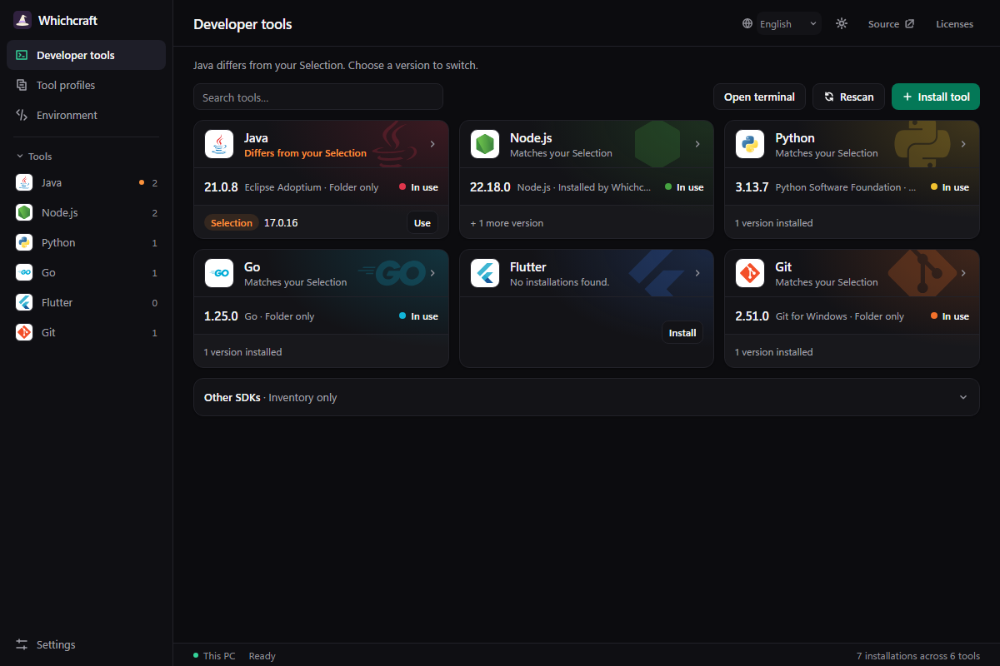

# Whichcraft

A Windows desktop app that finds, installs, switches, and uninstalls versions of Java, Node.js, Python, Go, Flutter, and Git, and decides which installation Windows uses by default.

It shows the difference between what you selected and what a new process actually gets, shows the exact environment changes before writing them, and can undo them.



**Website:** <https://nu-therabbit.github.io/Whichcraft/>

## Status

Version 0.1.0 has not been released yet, so there is no installer to download. Build it from source for now. Builds are not code signed, so Windows SmartScreen may warn when you run one.

## What it does

- **Finds installations** in PATH, the registry, standard locations, and folders you add.
- **Switches with a reviewed plan.** Paths are written straight into your environment with no shims, and the choice applies to the whole machine rather than one project.
- **Installs and updates** Temurin, Node.js, Python, Go, and Flutter through a pinned copy of [mise](https://mise.jdx.dev/) it manages itself. Git is switch-only.
- **Saves tool profiles,** named sets of versions you can apply in one step.
- **Edits environment variables** with staged changes, snapshots, and a command line for scripts.

The interface is available in English, Japanese, Simplified Chinese, Russian, Korean, and Vietnamese.

## Build from source

You need Windows, Node.js 22, and stable Rust.

```powershell
npm ci
npm run tauri dev
```

To build the NSIS and MSI installers:

```powershell
npm run tauri build
```

## Command line

After adding Whichcraft to PATH from the app, open a new terminal:

```powershell
whichcraft --help
whichcraft list
whichcraft set MY_VAR value          # dry run
whichcraft set MY_VAR value --apply  # writes to the registry
```

Running `whichcraft` with no command opens the app. Switching and installing tools happen in the app.

## Uninstalling

Uninstalling removes the app, its shortcuts, and its PATH entry. Tools installed through Whichcraft stay in place because PATH or a project may still use them. With the `.exe` installer, tick **Delete the application data** to also remove settings, Selections, Tool Profiles, snapshots, and undo history. The MSI has no such option and keeps them.

## Documentation

| Document | Covers |
|---|---|
| [CONTRIBUTING.md](CONTRIBUTING.md) | Development flow, tests, and translations |
| [DESIGN.md](DESIGN.md) | Architecture, security model, and data formats |
| [design-system/whichcraft/MASTER.md](design-system/whichcraft/MASTER.md) | Interface tokens and UX rules |
| [CONTEXT.md](CONTEXT.md) | Domain vocabulary |
| [docs/adr/](docs/adr/) | Architecture decisions |

## License

[MIT](LICENSE). Whichcraft is forked from [Envarly](https://github.com/iray-tno/envarly) by iray-tno.
